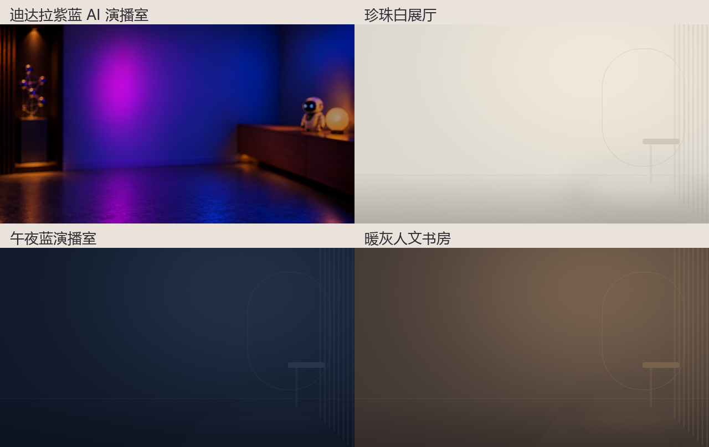

# 迪达拉口播成片 Skill

**0.2.0-preview · 已确认效果库、动态人物替景、宣传式预览。**

把拍好、剪好的口播和对应 SRT 交给 Agent：按文意制作真人字效、情景动画与完整成片，保留原声原速。背景杂乱时，先把原镜头中可见的人物动态分离，再放入选定的干净空间。

## 粉丝只需两句话

> 帮我安装这个 Skill：https://github.com/didalaAI/didala-talking-head-finish

> 调用 talking-head-finish，按照这个 Skill 剪辑我的口播视频和 SRT，保留原声原速，并给我选择干净背景。

已有旧版可说“更新到最新版本”。Agent 先读[安装约定](docs/INSTALL-FOR-AGENTS.md)，完整安装 skills/talking-head-finish 并验证宿主识别；未修改的受管旧版可备份升级。普通粉丝无需手工克隆、敲命令或先装 H3。

普通文字稿先由 Agent 用可用转写/对齐工具取得真实时码，不把文案均分到视频上。Codex、WorkBuddy、豆包工作都需要实际文件访问、命令执行和渲染能力；仅聊天的入口不能完成本地成片。WorkBuddy/豆包工作的真实客户端全流程仍需分别试用，不能把安装成功等同制作成功。

## 这一版具体有什么

- **23 项已确认效果**：9 项真人文字机制、8 组生成场景配方、6 项 MG。无手纸艺常用，珍珠白与夜紫银读取装置偶尔；已移除旧青色/黑色 PPT 路由、带手纸艺与未选中的石墨橙。
- **动态人物替景**：本地 RVM ONNX 适配器，保留发丝/手势的连续蒙版、独立前景与原声音源，按本期人物自动定位；可供穿身文字恢复遮挡。模型独立准备，不随仓库分发。
- **四种背景**：你熟悉的紫蓝 AI 演播室、珍珠白展厅、午夜蓝演播室、暖灰人文书房。默认包只含无人物底图。
- **宣传式预览**：36 秒安装效果样片；本期可从实际成片按 SRT 句子边界建立宣传样片。完整口播、节选预览与可编辑工程分别交付。
- **可选 H3/其他生成服务**：有可用服务就验证使用；没有由粉丝选择动态 MG 与素材、云服务、Agent 已有模型或稍后补镜头，不自动换服务或提交收费生成。

效果与制作要求在[Skill 入口](skills/talking-head-finish/SKILL.md)、[已确认清单](skills/talking-head-finish/references/approved-effects.json)、[人物替景说明](skills/talking-head-finish/references/matting.md)、[宣传预览说明](skills/talking-head-finish/references/promo-preview.md)。[下载本版](https://github.com/didalaAI/didala-talking-head-finish/releases/tag/v0.2.0-preview)可取得源代码与实际宣传样片。



## Agent 的执行入口

基础环境：Python ≥3.11、Node/npm 或 pnpm、FFmpeg/ffprobe/libass、Chrome 或 Edge。Node 依赖固定 Remotion 4.0.539 / React 19.2.0；本地抠像另需隔离 NumPy、ONNX Runtime、Pillow 及用户自己的 FP32 RVM ONNX 模型。

```text
python install_skill.py
python skills/talking-head-finish/scripts/studio.py doctor
python skills/talking-head-finish/scripts/studio.py demo --project projects/demo
python skills/talking-head-finish/scripts/studio.py setup --project projects/demo
python skills/talking-head-finish/scripts/studio.py render --project projects/demo
```

自己的视频由 `studio.py init --video <MP4> --srt <SRT> --project <空目录>` 初始化，再由 Agent 编写本期语义分镜、处理人物与字幕、实际渲染和审片。调用 Skill 不等于一个不经设计的固定模板；文案与素材质量、执行环境和可用生成服务影响结果。

安装到 Codex 当前用户目录的默认位置依据[官方技能文档](https://learn.chatgpt.com/docs/build-skills)；其他宿主使用实际支持的技能位置，详见[跨客户端边界](skills/talking-head-finish/references/host-compatibility.md)。

## 验证与许可

[验证记录](docs/VALIDATION.md)区分基础渲染、真实人物短段替景、宣传节选、宿主端到端及生成后端实测。默认原声原速 1.0、无 BGM；新主题要重新设计，不保证不同 Agent/模型逐像素复制同一视频。

原创代码采用 [MIT](LICENSE)。背景、字体、Remotion、抠像模型和生成服务各自许可见[第三方声明](THIRD_PARTY_NOTICES.md)；MIT 不替代它们。本仓不含作者私人人像、声音、账号、模型权重或已安装环境。私人测试视频留在本地，不上传到公开仓库。

```text
python -m unittest discover -s tests -v
python scripts/release.py audit
```
